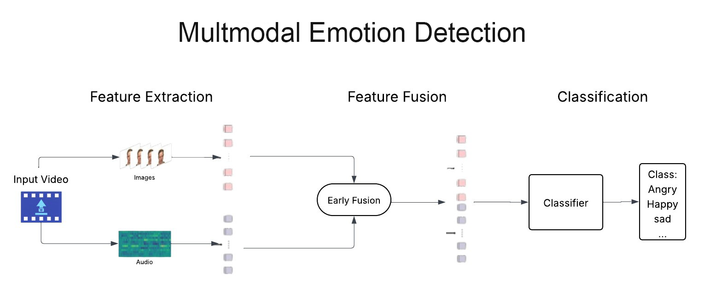

# 🎥 High-Accuracy Multimodal Emotion Recognition from Video

[](LICENSE)


[](https://github.com/MohameddEzzatt/Multimodal-Emotion-Recognition/stargazers)

> 🏆 **Published Research | Scientific Reports (Springer Nature) | 2026**
>
> This project contributed to a peer-reviewed scientific research paper published in **Scientific Reports**, a journal by Springer Nature.
>
> 📄 **[Read the Published Research Paper](https://www.nature.com/articles/s41598-026-58836-w)**

This repository presents an end-to-end **Multimodal Emotion Recognition System** designed to identify human emotions from video recordings by jointly analyzing two complementary modalities: **audio (speech)** and **visual (facial expressions)**.

The proposed framework introduces a **Hybrid Multi-View Deep Feature Fusion Architecture** that integrates acoustic features with deep visual representations extracted using an attention-based VGGFace (ResNet-50) model. Multiple fusion strategies, including Concatenation, Cross-Attention, Gated Fusion, and Multiplicative Fusion, are employed to capture complementary relationships between audio and visual modalities.

The resulting multimodal representations are fed into a **Stacking Ensemble Classifier** combining Support Vector Machines (SVM), Random Forest, and XGBoost to perform emotion classification.

The framework was experimentally evaluated on benchmark emotion recognition datasets using both conventional random-split and strict speaker-independent evaluation protocols to investigate its generalization capability across unseen speakers.

**This research work was published in Scientific Reports (2026), Springer Nature.**

🔗 **Publication DOI:** [10.1038/s41598-026-58836-w](https://doi.org/10.1038/s41598-026-58836-w)

---

## 📚 Scientific Publication

This project contributed to the research study:

**"Multimodal Emotion Recognition Using Hybrid Deep Feature Fusion Under Speaker-Independent Evaluation."**

The research was published in **Scientific Reports (2026)**, a peer-reviewed scientific journal published by Springer Nature.

### Publication Details

- **Journal:** Scientific Reports
- **Publisher:** Springer Nature
- **Year:** 2026
- **Volume:** 16
- **Article Number:** 19584
- **DOI:** [10.1038/s41598-026-58836-w](https://doi.org/10.1038/s41598-026-58836-w)

### Authors

Elhossiny Ibrahim, Mohamed Ezzat Ghoraba, and Ahmed Ezzat Ghoraba.

### Citation (APA)

Ibrahim, E., Ezzat Ghoraba, M., & Ezzat Ghoraba, A. (2026). Multimodal emotion recognition using hybrid deep feature fusion under speaker-independent evaluation. *Scientific Reports, 16*, Article 19584. https://doi.org/10.1038/s41598-026-58836-w

📄 **[Read the Full Research Paper](https://www.nature.com/articles/s41598-026-58836-w)**

---

## 🌟 Key Features

- 🧠 **Multimodal Analysis:** Leverages both audio and video channels to create a more robust and accurate understanding of emotional expressions.
- 🖼️ **Advanced Visual Feature Extraction:** Uses **VGGFace (ResNet-50)** with **Attention Pooling** to focus on the most expressive frames.
- 🎵 **Rich Audio Feature Extraction:** Employs **Librosa** to extract MFCCs, Spectral Centroid, ZCR, RMS, and other acoustic features.
- 🔗 **Intelligent Feature Fusion:** Combines modalities using **Concatenation, Cross-Attention, Gated Fusion, and Multiplicative Fusion**.
- ⚙️ **Ensemble Learning:** Uses a **Stacking Classifier** combining SVM, Random Forest, and XGBoost.
- 🔬 **Speaker-Independent Evaluation:** Investigates model generalization using speaker-independent evaluation protocols.
- 📄 **Published Research:** The research work was published in *Scientific Reports (Springer Nature)*.

---

## 🔬 Project Pipeline



The process is divided into **four main stages**:

### Stage 1: Data Preprocessing

- **Frame Extraction:** Sample videos at **3 FPS** and save frames.
- **Audio Extraction:** Extract audio as `.wav` files for acoustic analysis.

### Stage 2: Feature Extraction

- **Audio Features:** Extract **45 acoustic features** (MFCCs, ZCR, RMS, etc.) and save them as `ravdess_features.csv`.
- **Visual Features:**
  - Frames are passed through **VGGFace (ResNet-50)**.
  - **Attention Pooling** aggregates the most expressive frames.
  - Final features are saved as `video_features_vggface_attention.csv`.

### Stage 3: Feature Fusion

- **Dimensionality Reduction:** PCA reduces feature dimensions to 300 components.
- **Scaling:** StandardScaler normalization.
- **Fusion Model:** Combines audio and visual features through:
  - Concatenation
  - Cross-Attention (MultiHeadAttention)
  - Gated Fusion
  - Multiplicative Fusion
- Final fused features are saved as `fusion_features.csv`.

### Stage 4: Modeling and Training

- Split data into training, validation, and testing sets.
- **Train Stacking Classifier:** SVC + Random Forest + XGBoost → Meta SVC.
- Evaluate model performance.
- Save trained models and preprocessing components, including scalers, PCA, fusion models, and the stacking classifier.

---

## 📊 Results

**Final Test Accuracy:** `93.06%`

| Emotion | Precision | Recall | F1-Score |
|---|---:|---:|---:|
| Angry | 0.97 | 0.89 | 0.93 |
| Calm | 0.93 | 0.97 | 0.95 |
| Disgust | 0.95 | 0.95 | 0.95 |
| Fearful | 0.95 | 0.90 | 0.92 |
| Happy | 0.97 | 1.00 | 0.99 |
| Neutral | 0.94 | 0.89 | 0.92 |
| Sad | 0.87 | 0.89 | 0.88 |
| Surprised | 0.88 | 0.92 | 0.90 |

> **Note:** The reported accuracy above corresponds to the original test configuration. For a comprehensive assessment of generalization to unseen speakers, refer to the speaker-independent evaluation results and experimental protocols described in the published research paper.

---

## 🚀 How to Run

### 1. Clone the Repository

```bash
git clone https://github.com/MohameddEzzatt/Multimodal-Emotion-Recognition.git
cd Multimodal-Emotion-Recognition
```

### 2. Create Virtual Environment (Recommended)

```bash
python -m venv venv

# On Linux / macOS
source venv/bin/activate

# On Windows
venv\Scripts\activate
```

### 3. Install Dependencies

```bash
pip install -r requirements.txt
```

### 4. Download Dataset

- Download the **RAVDESS Dataset** from [Zenodo](https://zenodo.org/record/1188976).
- Extract the dataset into a folder named `RAVDESS dataset/` at the project root.

### 5. Run Jupyter Notebook

```bash
jupyter notebook
```

Open `main.ipynb` and execute the cells sequentially.

---

## 🛠️ Technologies Used

- **Core Libraries:** Python, NumPy, Pandas
- **Machine Learning:** Scikit-learn, XGBoost
- **Deep Learning:** TensorFlow, Keras
- **Data Processing:** OpenCV, MoviePy, Librosa
- **Feature Extraction:** VGGFace (ResNet-50), MFCC
- **Dimensionality Reduction:** PCA
- **Model Persistence:** Joblib

---

## 📖 Research & References

For further details about the proposed architecture, experimental methodology, fusion strategies, and speaker-independent evaluation, please refer to the published research paper:

**Ibrahim, E., Ezzat Ghoraba, M., & Ezzat Ghoraba, A. (2026).** Multimodal emotion recognition using hybrid deep feature fusion under speaker-independent evaluation. *Scientific Reports, 16*, Article 19584.

- [Nature / Scientific Reports](https://www.nature.com/articles/s41598-026-58836-w)
- [DOI: 10.1038/s41598-026-58836-w](https://doi.org/10.1038/s41598-026-58836-w)

---

## 📜 License

[](LICENSE)

This project is licensed under the **MIT License**. See the [LICENSE](LICENSE) file for details.
